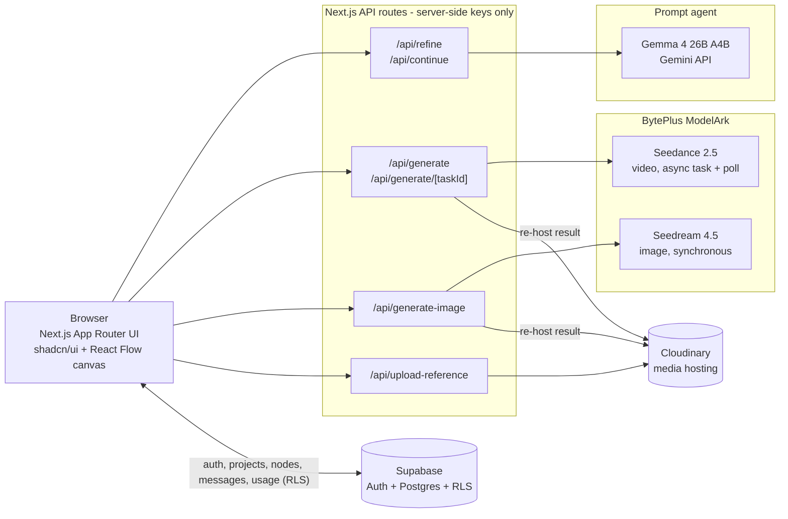

# Thunder

**Thunder is a conversational AI studio for video and image generation. You describe an idea, an agent turns it into a production-ready prompt, and BytePlus ModelArk renders it onto an infinite canvas.**

[](https://nextjs.org)
[](https://react.dev)
[](https://www.typescriptlang.org)
[](https://tailwindcss.com)
[](https://supabase.com)
[](https://cloudinary.com)
[](https://ui.shadcn.com)
[](https://thunder-nine-olive.vercel.app)

**Live demo:** https://thunder-nine-olive.vercel.app

---

## What it does

1. **Sign up / log in** with Supabase Auth. Projects and history persist across visits.
2. **Start a project** from the dashboard by describing what you want: a product ad, a cinematic clip, a still image. Pick **Video** or **Image** mode and optionally attach reference images.
3. **Pick a few options.** A click-to-choose brief form covers aspect ratio, duration, shot style, mood (video) or style, composition and mood (image), so the agent doesn't have to ask a series of questions.
4. **Refine with the agent.** A Gemma 4 agent reads the brief, any reference images and the node you have selected, then writes a structured generation prompt. It asks at most one clarifying question.
5. **Review and edit the prompt.** The refined prompt appears as an editable node on the canvas.
6. **Generate.** Video goes to **Seedance 2.5** as an async task that the app polls. Images go to **Seedream** and come back synchronously. The result is re-hosted on Cloudinary and replaces the prompt node on the canvas.
7. **Iterate.** Select an image or video node to use it as a reference, drag out of a node to branch a new generation, or ask the agent to "continue" a clip. Every node keeps its lineage, so a project reads as a spatial history of the creative thread.

## Features

- **Conversational prompt refinement:** Gemma 4 (`gemma-4-26b-a4b-it` via the Gemini API) with vision. It sees attached and selected images (videos as a still frame) and returns structured JSON (`clarifying` / `ready` / `redirected`), with guardrails against prompt injection and off-topic requests.
- **Infinite project canvas** built on React Flow. Prompt, image and video nodes are linked by lineage edges and manual reference edges, and you can disconnect a wire with its hover "x". Supports trackpad pan and pinch zoom.
- **Video generation** with BytePlus ModelArk Seedance 2.5 (`dreamina-seedance-2-5-260628`), including aspect ratio, duration (4 to 30 s), reference images, and video-to-video continuation.
- **Image generation** with BytePlus ModelArk Seedream 4.5 (`seedream-4-5-251128`, can be overridden with an env var), including multi-image references.
- **Reference images:** paste, drag-and-drop or attach in the chat rail, the dashboard, the draft-node popup, or straight onto the canvas. Files are validated client-side against Seedance's input rules (type, size, dimensions, aspect ratio).
- **Persistent media:** BytePlus result URLs expire, so every output is re-hosted on Cloudinary. The original BytePlus URL is kept for debugging.
- **Usage tracking:** each Gemma turn and BytePlus generation is logged to `usage_logs`, with a usage summary and per-entry breakdown in the dashboard top bar.
- **Clear errors:** BytePlus 4xx responses are parsed, and reference rejections (for example real-person faces in Seedance inputs) show BytePlus's own reason on the node, along with a retry option.
- **Project management:** a project dashboard with media thumbnails, a projects grid, and project deletion that cascades through all related rows.
- **Marketing landing page** with Seedance-generated hero and showcase videos.

## Architecture



Thunder has no separate backend. Next.js route handlers do all the server-side work (Gemma calls, BytePlus calls, Cloudinary uploads), which keeps every API key off the client. The browser reads and writes its own data through the Supabase client, and row-level security restricts each user to their own rows. `src/proxy.ts` refreshes the Supabase session on each request.

## Tech stack

| Layer | Technology |
| --- | --- |
| Framework | Next.js 16 (App Router, route handlers), React 19 |
| Language | TypeScript 5 |
| UI | Tailwind CSS 4, shadcn/ui (Base UI), lucide-react, tw-animate-css |
| Canvas | React Flow 11 |
| Prompt agent | Gemma 4 26B A4B (`gemma-4-26b-a4b-it`) via the Gemini API |
| Video generation | BytePlus ModelArk: Seedance 2.5 |
| Image generation | BytePlus ModelArk: Seedream 4.5 |
| Auth and database | Supabase (Auth, Postgres, row-level security) via `@supabase/ssr` |
| Media storage | Cloudinary |
| Hosting | Vercel |

## Database schema

Defined in [`supabase/schema.sql`](supabase/schema.sql), with additive migrations `002` to `005` in [`supabase/`](supabase/). RLS is enabled on every table.

| Table | Purpose | RLS policy |
| --- | --- | --- |
| `profiles` | Display name per `auth.users` row, created automatically by an `on_auth_user_created` trigger | Select, insert and update own row (`auth.uid() = id`) |
| `conversations` | One per project (`/app/[projectId]`) | Owner has full access (`auth.uid() = user_id`) |
| `messages` | Agent chat history (`user` / `assistant`) | Owner via the parent conversation |
| `generation_tasks` | One per canvas node (`prompt` / `image` / `video`): status, prompt, Cloudinary `media_url`, original `byteplus_url`, `reference_urls[]`, ratio, canvas position, and `parent_id` for lineage | Owner via the parent conversation |
| `generation_references` | Many-to-many manual node-to-node reference links | Owner via task, then conversation |
| `usage_logs` | One row per Gemma turn or BytePlus generation: `source`, model, tokens, `cost_usd` | Owner (`auth.uid() = user_id`) |

Deleting a conversation cascades to its messages, tasks, references and usage rows.

## Project structure

```
src/
├── app/
│   ├── page.tsx                 # Landing page
│   ├── login/, signup/          # Supabase Auth pages
│   ├── app/
│   │   ├── page.tsx             # Dashboard (new project, recent projects)
│   │   ├── projects/page.tsx    # All projects grid
│   │   └── [projectId]/page.tsx # Project: chat rail + canvas
│   └── api/
│       ├── refine/              # Gemma: brief -> refined prompt
│       ├── continue/            # Gemma: continue/extend a prompt
│       ├── generate/            # Seedance: submit task, [taskId] poll
│       ├── generate-image/      # Seedream: generate image
│       └── upload-reference/    # Reference image -> Cloudinary
├── components/
│   ├── dashboard/               # Top bar (usage), project cards, new-project box
│   ├── project/                 # Canvas, nodes, chat rail, brief form, references
│   └── ui/                      # shadcn/ui primitives
├── lib/
│   ├── agent.ts                 # Gemma agent (system prompt, vision, guards)
│   ├── byteplus.ts              # ModelArk Seedance + Seedream client
│   ├── cloudinary.ts            # Media re-hosting
│   ├── db.ts                    # Supabase data access
│   ├── references.ts            # Reference-image validation/helpers
│   └── supabase/                # Browser + server clients
└── proxy.ts                     # Supabase session refresh
supabase/                        # schema.sql + migrations
scripts/backfill-cloudinary.mjs  # One-off: re-host older BytePlus URLs
```

## Getting started

### Prerequisites

- Node.js 20+
- A Supabase project, a Cloudinary account, a Google AI Studio (Gemini API) key, and a BytePlus ModelArk API key with Seedance 2.5 and Seedream enabled

### Setup

```bash
git clone https://github.com/MaximumCell/thunder.git
cd thunder
npm install
cp .env.example .env.local   # then fill in the values
```

Environment variables (names only, see [`.env.example`](.env.example)):

| Variable | Used for |
| --- | --- |
| `GEMINI_API_KEY` | Gemma 4 prompt agent |
| `BYTEPLUS_API_KEY` | ModelArk Seedance / Seedream |
| `BYTEPLUS_ENDPOINT` | Listed in `.env.example` (the ModelArk base URL is currently set in `src/lib/byteplus.ts`) |
| `BYTEPLUS_IMAGE_MODEL` | Optional Seedream model override |
| `NEXT_PUBLIC_SUPABASE_URL` | Supabase project URL |
| `NEXT_PUBLIC_SUPABASE_ANON_KEY` | Supabase anon key (client + server) |
| `SUPABASE_SERVICE_ROLE_KEY` | Only for the `backfill:cloudinary` maintenance script |
| `CLOUDINARY_CLOUD_NAME`, `CLOUDINARY_API_KEY`, `CLOUDINARY_API_SECRET` | Media hosting |

### Database

In the Supabase SQL editor, run `supabase/schema.sql`. It includes every table and policy for a fresh install. The numbered files are additive migrations for older databases.

### Run

```bash
npm run dev     # http://localhost:3000
npm run build && npm start
npm run lint
```

## How it was built

Thunder was built end-to-end with **Claude Code**, using a structured agentic workflow:

- **[`plan.md`](plan.md)** is the source of truth. It records the architecture, the locked product decisions, the BytePlus API notes, and an ordered build plan. Steps go from setup, landing page and a mock-data frontend, through the Gemma agent, the canvas UI and Seedance integration, to Supabase, Cloudinary, usage tracking and Seedream.
- **[`PROGRESS.md`](PROGRESS.md)** is the memory that carries over between sessions. Each session reads it first and updates it last with what changed, what was verified and what wasn't, known issues, and what to do next.
- **Checked against the real APIs:** BytePlus request shapes, model IDs and error codes come from the live ModelArk docs and console. Agent behaviour was checked with live calls, and the log notes which features have and haven't been tested end-to-end.
- **Human in the loop:** the owner reviewed each change before it was committed.

## Roadmap

Known gaps and next steps noted in `PROGRESS.md`:

- Store the chosen video `duration` on `generation_tasks`, so a retry after reload keeps the original length.
- Support real-person faces in Seedance references, either through BytePlus authorized assets (`asset://<id>`) or through Seedream 5.0 lite outputs as trusted inputs.
- Clean up Cloudinary assets when a project is deleted.
- Show an estimated cost before a generation starts.

## Author

**Rao Ali Hassan**

- LinkedIn: [ali-hassan-36a43b318](https://www.linkedin.com/in/ali-hassan-36a43b318/)
- GitHub: [@MaximumCell](https://github.com/MaximumCell)
